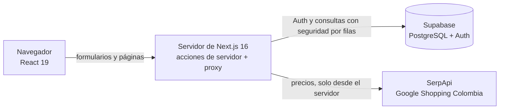

# Arquitectura de Cuentas Claras

Un solo repositorio con Next.js: el navegador muestra las pantallas y el servidor de Next.js (acciones de servidor y rutas) valida, protege las claves y habla con los servicios externos.

## Capas del código
| Carpeta | Qué contiene |
|---|---|
| `src/app/(sitio)/` | Páginas públicas: portada, login, registro, recuperar y restablecer contraseña, contacto y ayuda |
| `src/app/panel/` | Portal privado: inicio, gastos, registrar, presupuesto y recomendar compras |
| `src/app/auth/` | Acciones de autenticación y el callback del correo |
| `src/components/` | Interfaz agrupada por zona: `home`, `layout`, `panel`, `auth`, `ui` |
| `src/lib/` | Lógica sin interfaz (validaciones, cálculos, consultas a Supabase en `*-servidor.ts`, `precios/`) |
| `src/config/site.ts` | Nombre del sitio, menú y las 12 categorías de gasto |
| `src/proxy.ts` | Renueva la sesión y protege `/panel` (en Next 16 reemplaza a `middleware`) |
| `supabase/migrations/` | Cambios de la base de datos, en SQL, con fecha en el nombre |

Regla de dependencias: los componentes usan `lib/` y `config/`; `lib/` nunca importa componentes.

## Decisiones de diseño
- **La seguridad está en la base de datos:** cada tabla de usuario lleva seguridad por filas (`(select auth.uid()) = user_id`), así que aunque una acción tuviera un error, nadie puede ver datos ajenos.
- **Se valida dos veces:** en el formulario (para dar respuesta rápida) y en el servidor (porque el navegador se puede saltar).
- **Las claves secretas solo viven en el servidor:** `SERPAPI_API_KEY` no lleva el prefijo `NEXT_PUBLIC_`.
- **Datos dinámicos detrás de `Suspense` y `await connection()`:** requisito de `cacheComponents` en Next 16.
- **Sin IA en el producto:** el comparador de precios detecta el tipo de producto con un diccionario y reglas, no con un modelo.
